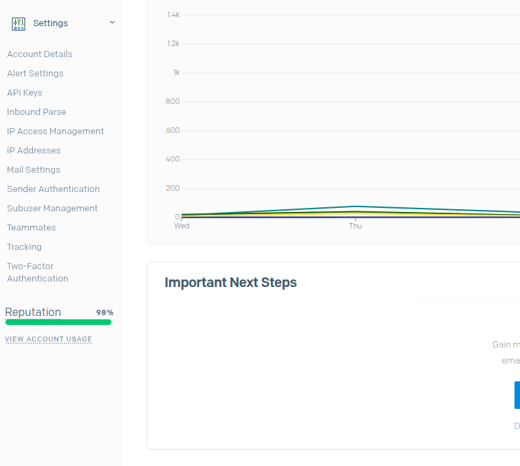
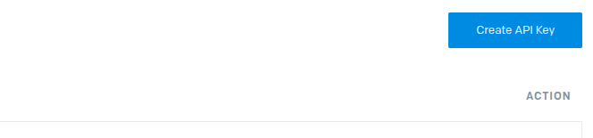
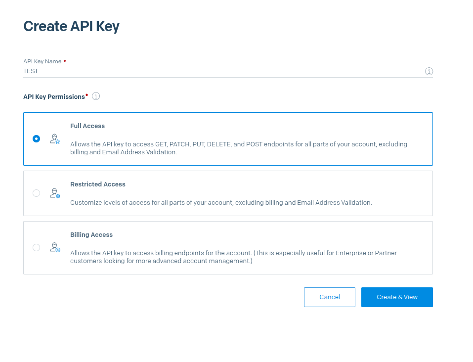
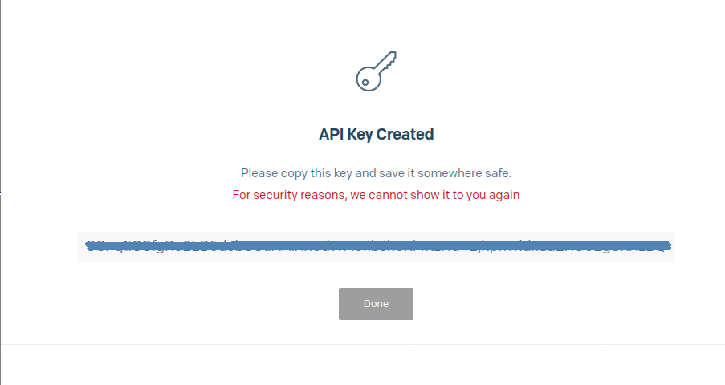

# Platform

Before installing the CREDEBL Platform services, it is essential to ensure that your environment meets certain prerequisites. Properly setting up these requirements will help facilitate a smooth installation process and optimal performance of the platform. Following these guidelines will help prevent potential issues and ensure that the CREDEBL Platform services are installed and operate as intended.&#x20;

## System requirements

Here is the list of software needed to get started:&#x20;

* **Operating System**:&#x20;
  *   **Supported Architectures:** ARM and AMD (x86)

      > **Note:** Support for ARM and AMD servers is available starting from **v2.1.0**. Versions prior to v2.1.0 only support AMD (x86) architecture.
* **Git**: Ensure you have Git installed (version **2.34.1 or higher**)
* **Docker Engine**: Required for containerization
  * **Linux**: Docker will be automatically installed by the setup script.
  * **macOS**:&#x20;
    * **Install manually**: Download Docker Desktop from [docker.com](https://www.docker.com/products/docker-desktop/)
    * **Launch Docker**: After installation, open the Docker Desktop application.
*   **Available Ports**:&#x20;

    The platform requires the following ports to be available on your machine:

    * **5432**: Default PostgreSQL database port
    * **5000**: CREDEBL API service
    * **4222**: NATS messaging system
    * **6379**: Redis caching service
    * **8080**: Keycloak service port
    * **4000**: Schema file server port


Ensure these ports are not blocked by your firewall or occupied by other applications.


***

## Prerequisites

Here is the list of prerequisites we will need for CREDEBL:

* [Docker / Docker compose](https://docs.docker.com/compose/install/standalone/)​
* [PostgreSQL](../../contribute/setup/service-setup.md#postgresql) (>= 14)
* ​[NATS](../../contribute/setup/service-setup.md#nats) (>= 2.6.4)
* ​[REDIS](../../contribute/setup/service-setup.md#redis) (>= 7.4)
* ​[Keycloak](../../contribute/setup/service-setup.md#keycloak) (>= 25.0.6)
* [AWS S3 Configuration Requirements](https://aws.amazon.com/)
  * The platform uses Amazon S3 for secure file storage. Prepare your:
    * AWS Access Key ID
    * AWS Secret Access Key
    * S3 Bucket Name
    * AWS Region


Instead of placing these credentials directly in your `.env` file, you can optionally store them in an OpenBao server and have the Platform source them at runtime. See [OpenBao Secret Storage](openbao.md).


<details>

<summary>AWS S3 configuration setup </summary>

* **IAM User Setup**
  * **Step 1: Create Dedicated IAM User**
  * **Step 2: Set Permissions**\
    Attach policy to user with these permissions:
    * `s3:PutObject`
    * `s3:GetObject`
    * `s3:ListBucket`
  * **Step 3: Generate Credentials**\
    After user creation, download:
    * Access Key ID
    * Secret Access Key\
      &#xNAN;_(Store securely for CREDEBL installation)_

-   **S3 Bucket Folder Requirements**

    Please ensure the following folder structure is created in the respective S3 buckets:

    | Bucket Type                 | Required Folders                                      | Access Level |
    | --------------------------- | ----------------------------------------------------- | ------------ |
    | **Connection URLs Storage** | <p><code>default/</code><br><code>persist/</code></p> | Public       |
    | **Organization Logos**      | `orgLogos/`                                           | Public       |
    | **Bulk Issuance**           | (root level)                                          | Private      |

</details>

* [Sendgrid](https://sendgrid.com/en-us)
  * SendGrid is used for sending email. You must obtain an API key from your SendGrid account.


Your SendGrid API key can optionally be stored in an OpenBao server instead of the `.env` file. See [OpenBao Secret Storage](openbao.md).


<details>

<summary>Sendgrid API key setup steps</summary>

* Log in to your SendGrid account:
  * Go to [https://app.sendgrid.com](https://login.sendgrid.com/login/password) and sign in with your credentials.


* Navigate to API Key Settings:-
  * On the left-hand navigation panel, click on "Settings".
  * Under Settings, select "API Keys".



* Create a New API Key:
  * Click on the "Create API Key" button.



* Choose one of the following access levels:
  * Enter a meaningful name for your API key to help you identify its purpose later.
  * Full Access – Grants complete access to all endpoints.
  * Restricted Access – Allows you to configure fine-grained permissions for each API category.
  * Billing Access – Provides access only to billing-related endpoints.
  * Click the "Create & View" button.



* Secure Your API Key:
  * Your API key will be displayed only once, make sure to copy and save this key securely in a password manager or secure vault.



\
Note:-&#x20;

* Do not hard-code the key in your application code.
* Avoid committing the key to any public repositories (e.g., GitHub)

</details>


**Note:** PostgreSQL, NATS, Redis, and Keycloak will be automatically installed when you run the setup script, so there's no need to install or configure them manually beforehand.\
However, you must have your **AWS credentials** and **SendGrid API key** ready before executing the script.


### CREDEBL **Installation Steps**

To setup, use the provided script which automatically checks your environment, installs Docker Engine, Docker Compose and Terraform on Linux, and runs the `docker compose up` command. This helps ensure all dependencies are met and streamlines the startup process for CREDEBL.

#### Option 1: Local deployment&#x20;

1.  **Clone the Repository**\
    Begin by cloning the CREDEBL installation repository from GitHub. This repository contains all necessary scripts and configurations.

    ```
    git clone -b main https://github.com/credebl/install.git && cd install/local-deployment
    ```
2.  **Grant Execution Permissions**

    The installation script requires executable permissions to run.

    ```
    chmod +x setup.sh
    ```

    This command makes the `setup.sh` script executable.
3.  **Execute the Setup Script**

    Run the setup script to begin the automated installation process.

    ```
    ./setup.sh
    ```

This script will:

* Create and configure the database
* Install and configure Keycloak
* Set up the schema file server
* Seed the database with initial data
* Launch all required services in separate terminal tabs (each tab will be automatically named for its service, and new services will start a few seconds apart)

After the script completes, the backend and agent services will be running.\
You will need to start the frontend separately by following the instructions [here](../../contribute/setup/studio.md).

#### Option 2: Docker Deployment

1.  **Clone the Repository**\
    Begin by cloning the CREDEBL installation repository from GitHub. This repository contains all necessary scripts and configurations.

    ```
    git clone -b main https://github.com/credebl/install.git && cd install/docker-deployment
    ```


2.  **Grant Execution Permissions**

    The installation script requires executable permissions to run.

    ```
    chmod +x setup.sh
    ```

    This command makes the `setup.sh` script executable.


3.  #### **Execute the Setup Script**

    Run the setup script to begin the automated installation process.

    ```
    ./setup.sh
    ```

**What the script does**:

1. **Environment Check**: Verifies your OS (Linux/macOS) and architecture
2. **Installs Dependencies**
   * **Linux**: Auto-installs Docker and Docker Compose
   * **macOS**: Requires manual Docker installation first
3. **Sets Up Terraform**
   * Installs Terraform (if missing)
4. **Keycloak Configuration**
   * Initializes Keycloack configuration
5. **User Input Prompt**: Requests the following details:
   * Your machine's **IP address** (for network configuration).
   * **SendGrid API Key** (for email services).
   * **AWS S3 credentials** (for file storage).
6. **Execute Docker command**
   * Executes **docker compose up** command.

The script will then deploy all necessary containers and services.

***

### Verify the Installation <a href="#verify-the-installation" id="verify-the-installation"></a>

After installation, verify that all components are running correctly.

*   Run the following command to list all active Docker containers:

    ```
    docker ps
    ```

    * Initially, you should see **21 services running**
    * After a few minutes, the seed service will automatically stop
    * Final running state should show **20 active services**

<details>

<summary>Show all containers</summary>


```
Credo-Controller
Agent-Service
Agent-Provisioning-Service
Verification-Service
Organization-Service
Ledger-Service
Issuance-Service
Connection-Service
User-Service
Cloud-Wallet-Service
Utility-Service
Webhook-Service
Geolocation-Service
Notification-Service
API-Gateway
Seed-Service
Postgres
Redis
Schema-File-Server
NATS
Keycloak
```


</details>

* #### **Access the CREDEBL API**

Once all containers are running, you can access the CREDEBL API\


### **Tearing Down the Infrastructure**

When you no longer need the local infra, you can clean up all resources using the provided script.

1.  **Grant Permissions to the Destroy Script**

    Ensure the script has executable permissions:


    ```
    chmod +x destroy.sh
    ```
2.  #### **Run the Destroy Script**

    Execute the script to remove all Docker resources:


    ```
    ./destroy.sh
    ```


    **This script will**:

    1. Stop all running containers.
    2. Remove all Docker containers, volumes, and images associated with CREDEBL.
    3. Clean up any temporary files or network configurations.

***

### **Additional Notes**


* **Firewall Configuration**:\
  If you encounter connection issues, ensure your firewall allows traffic on the ports listed in the prerequisites.
*   **Troubleshooting**:\
    If containers fail to start, check the logs using:


    ```
    docker logs <container_name>
    ```
