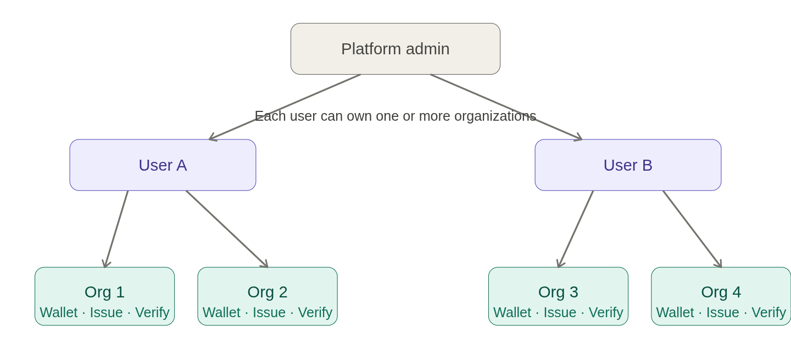

# Ecosystem

#### Layer 1 — Users & Organizations

<figure><figcaption></figcaption></figure>

Every organization gets its own wallet and can independently issue and verify credentials.

***

#### Layer 2 — Ecosystems

The platform admin can designate any organization as an Ecosystem Lead. That lead then governs an ecosystem by inviting other organizations to join as Ecosystem Members.

<figure><figcaption></figcaption></figure>

The invite flow works in two hops: admin → lead organization, then lead → member organizations. Organizations that reject the invite remain outside the ecosystem with no access to its data.


You can make code blocks [span the full width of your window](https://gitbook.com/docs/creating-content/blocks#full-width-blocks) by clicking on the **Options menu** <i class="fa-grip-dots-vertical">:grip-dots-vertical:</i> icon in GitBook next to the block and choosing **Full width.**


