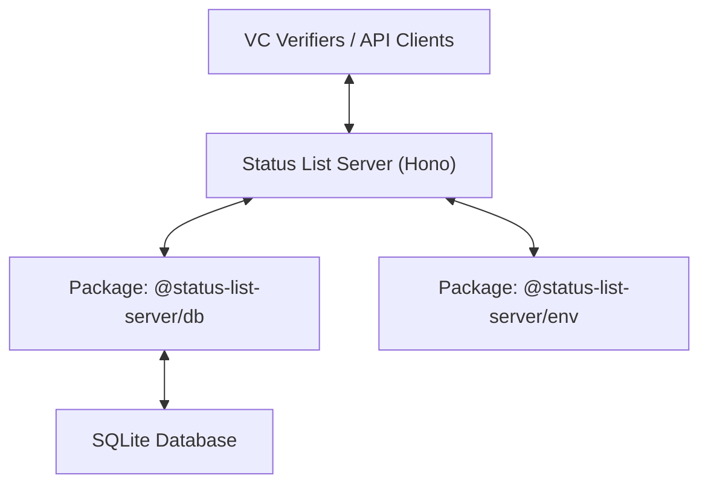

# Status List Server

***

### 🏗️ Architecture Overview

The project is structured as a **monorepo** managed with **Bun**, utilizing a clear separation between the server logic and core packages.

#### Component Diagram



#### Folder Structure

* `apps/server`: The main Hono application which exposes the REST API.
* `packages/db`: Contains the database schema, Drizzle ORM configuration, and query functions.
* `packages/env`: Centralized environment variable validation using Zod and T3 Env.

***

### 📡 API Reference

The server provides a simple RESTful interface for managing status lists. All write operations require an `x-api-key` header.

#### Authentication

Requests to POST and PATCH endpoints must include the following header: `x-api-key: <your-configured-api-key>`

#### Endpoints

**1. Health Check**

* **Method:** `GET`
* **Path:** `/health`
* **Auth:** None
* **Response:** `{"status": "ok"}`

**2. Create Status List**

* **Method:** `POST`
* **Path:** `/status-lists`
* **Auth:** Required
*   **Body:**

    ```json
    {
      "id": "uuid-v4-string",
      "jwt": "base64-encoded-status-list-jwt"
    }
    ```
* **Description:** Validates the JWT structure and stores the new status list.

**3. Update Status List**

* **Method:** `PATCH`
* **Path:** `/status-lists/:list_id`
* **Auth:** Required
*   **Body:**

    ```json
    {
      "jwt": "base64-encoded-updated-status-list-jwt"
    }
    ```
* **Description:** Updates an existing status list. **Note:** The `bits` per status (e.g., 1 bit for revocation, 2 bits for suspension) cannot be changed after the list is created.

**4. Retrieve Status List**

* **Method:** `GET`
* **Path:** `/status-lists/:list_id`
* **Auth:** None
* **Response Type:** `application/statuslist+jwt`
* **Description:** Returns the raw JWT string for the requested status list ID.

***

### ⚙️ Environment Configuration

Configuration is managed via environment variables. These are strictly validated on startup.

| Variable       | Description                              | Example            |
| -------------- | ---------------------------------------- | ------------------ |
| `DATABASE_URL` | Connection string for SQLite             | `file:local.db`    |
| `API_KEY`      | Secret for authenticating write requests | `super-secret-key` |
| `PORT`         | The port the server should run on        | `3000`             |

***

### 🚀 Getting Started

#### Installation

```bash
bun install
```

#### Running in Development

```bash
bun run dev
```

#### Database Operations

* **Generate Migrations:** `bun run db:generate`
* **Run Migrations:** `bun run db:migrate`
* **UI Inspector:** `bun run db:studio`

#### Building for Production

```bash
bun run build
```

***

### 🐳 Docker Deployment

The project includes a `Dockerfile` for easy containerization.

```bash
docker build -t status-list-server .

docker run -d \
  -p 3000:3000 \
  -e DATABASE_URL=file:local.db \
  -e API_KEY=secure-api-key \
  status-list-server
```

***

### 🛡️ Best Practices & Features

* **Type Safety:** Full TypeScript implementation from API routes to database queries.
* **Fast Startup:** Utilizing Bun and Hono for sub-millisecond route handling.
* **Auto-Migrations:** Database migrations are applied automatically when the server starts.
* **Input Validation:** All API inputs are validated using Zod schemas.
